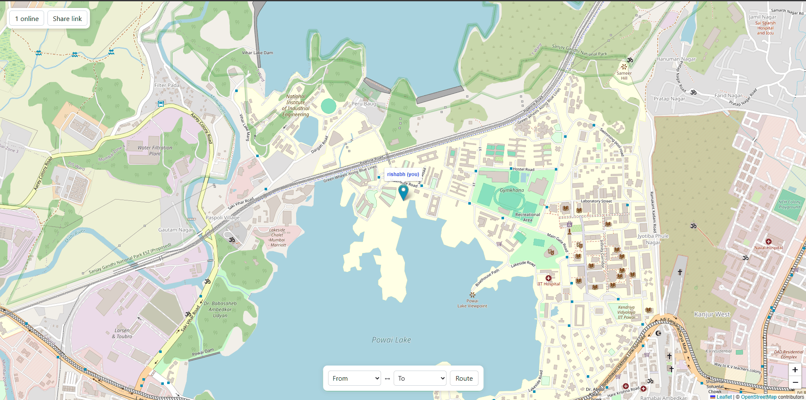

# Real-Time Location Tracking

Share your live location with a group and get road directions between any two members. Each group gets its own private room link, so only people you send the link to can see you.

Built with **Node.js**, **Express 5**, **Socket.IO** and **Leaflet** (OpenStreetMap tiles, OSRM routing).

**Live demo:** https://realtime-location-tracking-5t0p.onrender.com
(hosted on Render's free tier, so the first load after a quiet period can take about 30 s)



## Features

- **Private rooms.** Opening the app creates a random room (`/?room=abc123xyz0`). Share the link to invite people; other rooms can't see you.
- **Live markers** with name labels, updated as people move.
- **Instant snapshot for late joiners.** Anyone who joins sees every current member right away, not only after they move.
- **Road routing** between any two members, with distance and ETA. The route refreshes automatically as either person moves.
- **Follow mode.** The map follows you until you pan it; a "Re-center on me" button brings it back.
- **Clear location states:** waiting for a fix, permission blocked (with a Retry button), HTTPS required, connection lost and reconnecting.
- **Mobile friendly**, with the native share sheet on phones and copy-to-clipboard on desktop.

## Security and privacy

- Usernames are always rendered as text (`textContent`), never as HTML, so names can't inject scripts.
- The server is the source of truth: the user id and name in every broadcast come from the server, so a client can't move or impersonate someone else.
- Coordinates are validated (finite, within ±90 / ±180) and each connection is rate limited to one update per second. Payloads over 10 KB are rejected.
- Locations are only sent to members of the same room and are kept in memory only while someone is connected. Nothing is written to disk.
- The client only sends an update after moving at least 3 m, or every 15 s as a heartbeat, which keeps traffic low.

## Run locally

Requires Node.js 20.11 or newer.

```bash
npm install
npm run dev     # auto-restarts on changes (nodemon)
# or
npm start
```

Open http://localhost:3000, then open the same link in a second tab or browser to see two users.

> Browsers only allow geolocation on **HTTPS** or **localhost**. To test on your phone over Wi-Fi, use an HTTPS tunnel such as `npx localtunnel --port 3000` or `cloudflared tunnel --url http://localhost:3000`. A plain `http://192.168.x.x:3000` address will not get location access.

## Tests

```bash
npm test
```

Starts the server and checks with real Socket.IO clients: static assets, input validation, room isolation, the late-joiner snapshot, protection against id and name spoofing, rate limiting and disconnect cleanup.

## Deploy

The app needs a long-running Node server with WebSocket support. **Vercel and Netlify serverless functions will not work** for the Socket.IO part.

### Render (free tier)

1. Push this repo to GitHub.
2. In Render, choose **New > Blueprint** and select the repo. `render.yaml` sets everything up (build command, start command, `/healthz` health check).
3. Open the `https://<name>.onrender.com` URL. HTTPS is automatic, so geolocation works.

The free tier sleeps after inactivity, so the first visit can take around 30 s to wake.

### Railway / Fly.io / any Docker host

A `Dockerfile` is included:

```bash
docker build -t location-tracker .
docker run -p 3000:3000 location-tracker
```

Put it behind HTTPS (the platforms above do this for you).

### Environment variables

| Variable | Default | Purpose |
|---|---|---|
| `PORT` | `3000` | Port to listen on. Most platforms set this automatically. |
| `CORS_ORIGIN` | unset | Only needed if the page is served from a different origin than the server. |

## Limitations

- **Single instance.** Room state lives in server memory. To run several instances, add the [Socket.IO Redis adapter](https://socket.io/docs/v4/redis-adapter/) and keep room state in Redis.
- **Routing** uses the public OSRM demo server (`router.project-osrm.org`), which is rate limited and meant for light use. For heavier traffic, self-host OSRM or switch the router (Mapbox, GraphHopper). The app limits re-routing to once every 10 s.
- **Map tiles** come from `tile.openstreetmap.org`, subject to the [OSM tile usage policy](https://operations.osmfoundation.org/policies/tiles/). Use a tile provider for high traffic.

## Project structure

```
index.js              Express + Socket.IO server (rooms, validation, rate limiting)
views/index.ejs       Page markup
public/js/script.js   Map, geolocation, rendering, routing
public/css/style.css  Styles
test/server.test.js   Integration tests
Dockerfile, render.yaml
```

## Credits

Map data © [OpenStreetMap](https://www.openstreetmap.org/copyright) contributors. Routing by [OSRM](http://project-osrm.org/) via [Leaflet Routing Machine](https://www.liedman.net/leaflet-routing-machine/).
